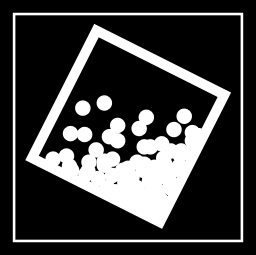
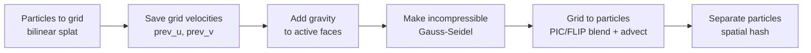

<p align="center">
  
</p>

<h1 align="center">PIC/FLIP Fluid Simulation in C</h1>

<p align="center">
  A 2D particle-in-cell fluid simulator written from scratch in C, with a live tuning panel.<br>
  Staggered MAC grid · PIC/FLIP blending · ~600 lines of solver · one dependency (raylib)
</p>

<p align="center">
  
  
  
</p>

https://github.com/user-attachments/assets/2198e55c-8e0c-4269-9eb2-0d4384435004

---

I made this in partial fulfillment of MATH F266 and to test out what the simulation would look like before I implemented it in hardware. The hardware implementation can be found [here](https://github.com/clodman84/fluid-sim-necklace).

## Features

- **PIC/FLIP hybrid** with a blend slider: 0 is pure PIC (smooth and damped), 1 is pure FLIP (lively and noisy)
- **Staggered MAC grid**: `u` velocities on vertical faces, `v` on horizontal faces
- **Incompressibility projection** with Gauss-Seidel sweeps, over-relaxation and density-based drift compensation
- **Particle separation** using a spatial hash, so particles don't clump
- **Fixed 60 Hz timestep** with an accumulator, so the physics is independent of render FPS
- **Debug overlays**: particles, per-cell pressure heatmap, face velocity vectors, and per-cell divergence numbers
- **Live control panel**: pause/reset, grid size from 4x4 to 40x40, gravity, and every solver parameter

## Quick start

You need a C compiler and [raylib](https://www.raylib.com/) installed.

```bash
git clone https://github.com/clodman84/fluid-sim.git
cd fluid-sim
mkdir -p bin
./compile.sh      # gcc main.c flip.c -O3 -o bin/flip -lraylib -lm
./bin/flip
```

The solver uses POSIX `random()`, so Linux and macOS work out of the box.

## Controls

Everything is in the panel on the right of the window.

| Control | Effect |
| --- | --- |
| **Play / Pause** | Freeze and resume the simulation |
| **Reset** | Rebuild the simulation with the current grid size and particles per cell |
| **Draw particles / pressure / velocity / divergence** | Toggle the overlays |
| **Simulation width / height** | Grid resolution, 4 to 40 cells (applied on reset) |
| **Gravity X / Y** | Any direction, from -30 to 30 |
| **Flip blend** | PIC/FLIP ratio, 0 to 1 |
| **Gauss-Seidel iterations** | Projection quality, 1 to 32 |
| **Boundary damping** | Velocity multiplier at the walls; -1 is a perfect elastic bounce |
| **Collision iterations** | Particle separation passes per step |
| **Particle radius** | Collision radius and drawn size |
| **Drift compensation** | How hard over-dense cells are pushed apart |
| **Overrelaxation** | Gauss-Seidel over-relaxation factor, 0.1 to 2.5 |
| **Particles / cell** | Seeding density (applied on reset) |

## How it works

Each step of `compute()` in [`flip.c`](flip.c) runs six stages:



1. **Particles to grid.** Each particle's velocity is distributed to the four nearest `u` faces and four nearest `v` faces with bilinear weights, then normalized. Cells containing particles become `FLUID`; the rest are `AIR`. Per-cell density is the particle count divided by the seeding count.
2. **Save.** The grid velocities are copied, because FLIP needs the change in velocity caused by the grid forces.
3. **Gravity.** Added only to faces that border at least one fluid cell.
4. **Projection.** For each fluid cell, the divergence `(u_right - u_left) + (v_top - v_bottom)` is computed, over-relaxed, and corrected by adjusting the cell's faces. Over-dense interior cells get an extra push from the drift-compensation term so the fluid doesn't compress over time. This repeats `gauss_iters` times.
5. **Grid to particles.** New velocity is `lerp(PIC, FLIP, flip_blend)`, where PIC is the grid velocity sampled at the particle and FLIP is the particle's old velocity plus the grid velocity change. Particles are then advected and bounced off the walls.
6. **Separation.** Overlapping particles are pushed apart using a spatial hash with cell size equal to the particle diameter, for `particle_collision_iters` passes.

### Default parameters

Defined in [`flip.h`](flip.h).

| Parameter | Default |
| --- | --- |
| Grid | 8 x 8 cells |
| Particles per cell | 4 |
| FLIP blend | 0.95 |
| Gauss-Seidel iterations | 4 |
| Boundary damping | -1.0 |
| Collision iterations | 2 |
| Particle radius | 0.25 cells |
| Drift compensation | 1.0 |
| Overrelaxation | 1.9 |

## Project layout

```
flip.h      types, tunable defaults, public API
flip.c      the solver: P2G, projection, G2P, particle separation
main.c      raylib window, rendering, overlays, control panel
compile.sh  one-line build
docs/       notes
assets/     logo and media
```

## Limitations

- 2D only, single-threaded, CPU only
- The only solid boundaries are the domain walls; there are no obstacles
- The projection is a direct sweep over face velocities, not a pressure Poisson solve. The pressure heatmap is a pressure-like potential accumulated from the corrections, meant for visualization
- Initial condition is fixed to a half-filled domain

## Further reading

- Zhu & Bridson, *Animating Sand as a Fluid*, SIGGRAPH 2005: the PIC/FLIP blend
- Bridson, *Fluid Simulation for Computer Graphics*
- Matthias Müller's *Ten Minute Physics* FLIP tutorial
